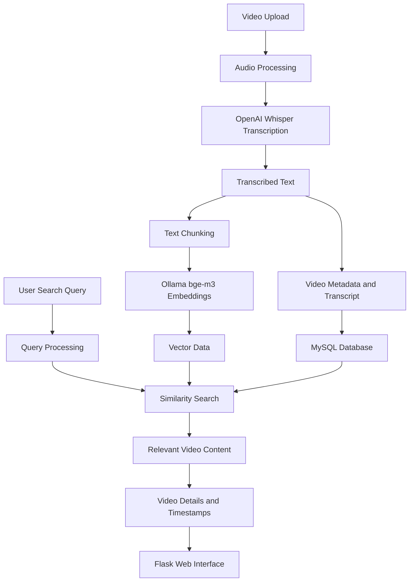
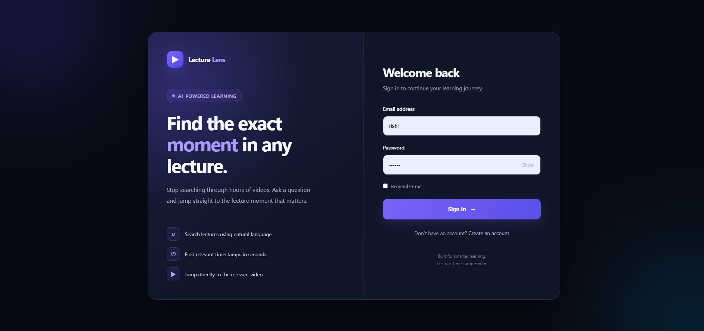
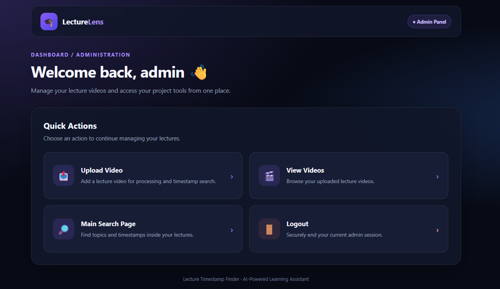
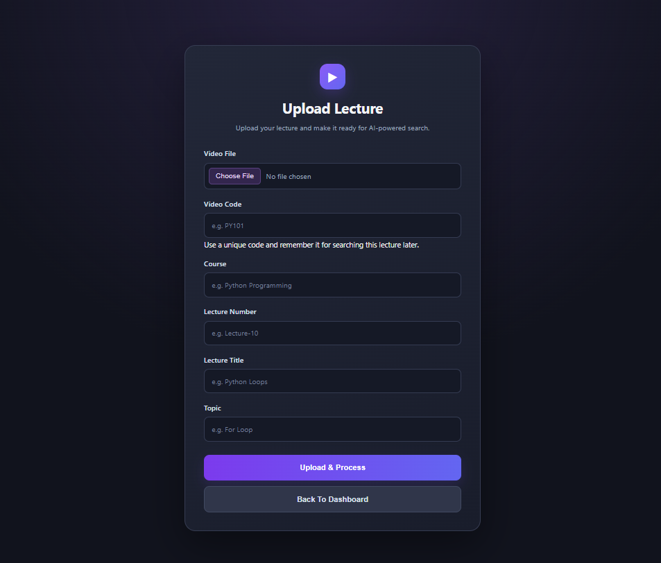
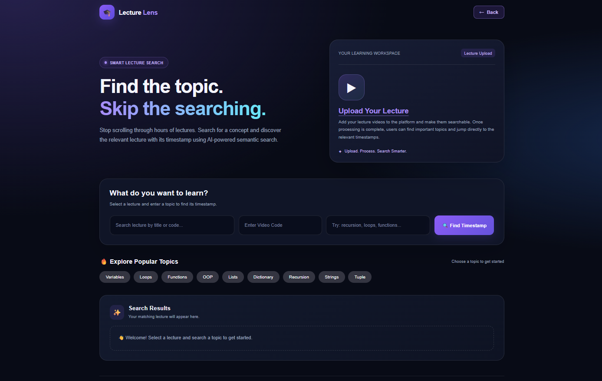

# 🎓 LectureLens

**Find Any Topic. Jump to the Exact Moment.**

LectureLens is a web application designed to help users find specific information within long videos without manually searching through hours of content. It can be used for various purposes, including educational lectures, office meetings, professional discussions, training sessions, and other video-based content.

By combining speech-to-text transcription, text embeddings, similarity search, database storage, and a Flask-based web interface, LectureLens enables users to search for specific topics, retrieve relevant video content, and locate the corresponding timestamps quickly and efficiently.

---

## 🌐 Live Demo

**Live Demo:** Currently, a public live demo is not available due to deployment limitations associated with running Ollama and its BGE-M3 embedding model on free hosting platforms.

LectureLens currently supports local execution with the required services and models configured on the user's machine.

- **GitHub Repository:** [Rishiraj-Singh-Thakur/LectureLens](https://github.com/Rishiraj-Singh-Thakur/LectureLens)

---

## 📌 Project Overview

LectureLens is designed to make information retrieval from long videos faster and more efficient. Whether it is an educational lecture, office meeting, corporate training session, technical discussion, or any other recorded video, users can search for specific topics instead of manually navigating through hours of content.

By leveraging speech-to-text transcription, text chunking, embedding generation, and similarity-based retrieval, LectureLens identifies relevant video content and its associated timestamps, allowing users to quickly find and revisit the information they need.

The project brings together:

- Video upload and processing
- Audio transcription using OpenAI Whisper
- Text chunking for efficient content retrieval
- Embedding generation using Ollama's `bge-m3` model
- Semantic similarity search using Scikit-learn
- MySQL database integration for lecture and video information
- A Flask-based web application with HTML, CSS, and JavaScript
- An interactive search interface for finding relevant topics and timestamps

------------------------------------------------------------------------

## 🎯 Core Use Case

### 🔎 Topic Search and Timestamp Discovery

LectureLens allows users to search for specific topics within long videos and quickly find the relevant moments using associated timestamps.

**Example searches:**
- Where are Python loops explained?
- Find the discussion about project deadlines.
- Where is recursion covered?
- Find the explanation of a specific concept.
- What was discussed in the meeting about a particular topic?

The system retrieves relevant video content and displays matching results with their timestamps.

------------------------------------------------------------------------

## ✨ Main Features

### 1. 🔐 Login Interface
Provides a sign-in interface for secure application access.

### 2. 🧑‍💻 Admin Dashboard
Provides access to video management tools, uploaded content, and the search interface.

### 3. 🎬 Video Upload
Allows admins to upload videos with details such as video code, course, lecture number, title, and topic.

### 4. 🎙️ Speech Transcription
Uses OpenAI Whisper to convert video audio into text.

### 5. 🧠 Embedding Generation
Uses Ollama's `bge-m3` model to generate text embeddings.

### 6. 🔍 Similarity Search
Uses Scikit-learn to find content relevant to a user's search query.

### 7. ⏱️ Timestamp Discovery
Identifies relevant moments in videos and displays their associated timestamps.

### 8. 🗄️ MySQL Integration
Stores and retrieves video metadata and related information using MySQL.

### 9. 🌐 Web Interface
Provides an interactive user interface built with Flask, HTML, CSS, and JavaScript.

------------------------------------------------------------------------

## 🏗️ Project Architecture

The following diagram illustrates the overall video-processing and content-search workflow of LectureLens.



*This diagram provides a high-level overview of the system architecture. Individual processing steps may vary depending on the implementation.*

------------------------------------------------------------------------
## 🔄 How It Works

### 1. Video Upload
Users upload a video through the interface along with its relevant metadata.

### 2. Audio Processing
FFmpeg processes the video and extracts audio for transcription.

### 3. Transcription
OpenAI Whisper converts the extracted audio into text.

### 4. Text Preparation
The transcript is divided into smaller chunks, with timestamps and metadata linked to the relevant content.

### 5. Embedding Generation
Ollama's `bge-m3` model converts text chunks into vector embeddings.

### 6. Data Storage
Video metadata and related information are stored in MySQL, while vector data is managed by the project's vector workflow.

### 7. Search Query
Users enter a topic or question through the search interface.

### 8. Similarity Search
The system compares the query with stored embeddings to identify relevant video content.

### 9. Search Results
Relevant content, video details, and associated timestamps are displayed so users can quickly locate the required moment.

------------------------------------------------------------------------

## 🧰 Tech Stack

### Programming

-   Python

### Backend and Web Framework

-   Flask

### Frontend

-   HTML
-   CSS
-   JavaScript

### Database

-   MySQL
-   Flask-MySQLdb / MySQL client libraries used by the project

### Speech Transcription

-   OpenAI Whisper

### Embeddings

-   Ollama
-   `bge-m3`

### Similarity Search and Data Processing

-   Scikit-learn
-   NumPy
-   Pandas

### Media Processing

-   FFmpeg

### Development and Version Control

-   Anaconda
-   VS Code
-   Git
-   GitHub

------------------------------------------------------------------------

## 📂 Project Structure

``` text
Lecture Timestamp Finder (Project -2)/
│
├── 01_data/                         # Local source and processing data
│   ├── 01_Videos/                   # Source lecture videos (local)
│   ├── 02_audios/                   # Extracted audio (local)
│   └── processing/                  # Intermediate processing files (local)
│
├── 02_vectors/
│   └── chunk_vectors.npy            # Local vector data (excluded from Git)
│
├── 03_backend/
│   ├── lecture_links.py             # Lecture links and related functionality
│   ├── search_engine.py             # Search and retrieval logic
│   ├── sql_practice.py              # SQL-related practice/code
│   └── uploading_on_database.py     # Database upload functionality
│
├── 04_scripts/                      # Processing and utility scripts
│
├── 05_templates/
│   └── templates/                   # HTML templates
│
├── 06_static/
│   └── static/                      # CSS, JavaScript, and static assets
│
├── screenshots/
│   ├── login.png
│   ├── admin-dashboard.png
│   ├── upload-lecture.png
│   └── search-page.png
│
├── app.py                           # Flask application entry point
├── requirements.txt                 # Python dependencies
├── .gitignore                       # Files excluded from Git
├── .env                             # Local configuration; do not commit
└── README.md                        # Project documentation
```

**Note:** `01_data/`, local media files, `.env`, and the generated
`02_vectors/chunk_vectors.npy` are intentionally excluded from Git. The
directory tree above documents the local project layout; files excluded
by `.gitignore` will not appear in the GitHub repository.

------------------------------------------------------------------------

## 📊 Data and Processing

LectureLens processes lecture content to make it searchable.

The workflow includes:

-   Video and audio handling
-   Speech-to-text transcription
-   Preparing text for retrieval
-   Generating embeddings for text chunks
-   Retaining lecture metadata and timestamp associations
-   Retrieving relevant content in response to a search query

The project uses lecture content supplied for processing. Dataset size
and processing benchmarks are not listed here because they depend on the
local lecture collection and have not been specified.

------------------------------------------------------------------------

## 🧠 Search Workflow

``` text
Lecture Video
     ↓
Audio Processing
     ↓
Whisper Transcription
     ↓
Text Preparation and Chunking
     ↓
Ollama bge-m3 Embeddings
     ↓
Vector and Database Storage
     ↓
User Topic Query
     ↓
Similarity Search
     ↓
Relevant Lecture Matches
     ↓
Lecture Details and Timestamps
```

------------------------------------------------------------------------

## 📸 Application Screenshots

The screenshots below show the current LectureLens interface.

### 🔐 Login Page



The sign-in interface introduces LectureLens and provides access to the
application.

### 🧑‍💻 Admin Dashboard



The dashboard provides quick access to video upload, uploaded videos,
and the main search page.

### 🎬 Upload Lecture



The upload form accepts a video file and lecture metadata, including
video code, course, lecture number, title, and topic.

### 🔎 Main Search Page



The search interface lets users choose a lecture, enter a topic, explore
popular programming topics, and view matching results.

------------------------------------------------------------------------

## ⚙️ Local Setup

### 1. Clone the Repository

``` bash
git clone https://github.com/Rishiraj-Singh-Thakur/LectureLens.git
cd LectureLens
```

### 2. Install Python Dependencies

Use a Python environment suitable for the project's dependencies, then
run:

``` bash
pip install -r requirements.txt
```

### 3. Install and Configure Required Tools

Make sure the following are installed and configured:

-   MySQL Server
-   Ollama
-   FFmpeg

Download the embedding model used by the project:

``` bash
ollama pull bge-m3
```

Ensure the Ollama service is running when the application needs it.

### 4. Configure Environment Variables

Create a `.env` file in the project root:

``` env
FLASK_SECRET_KEY=your_secret_key
MYSQL_HOST=localhost
MYSQL_PORT=3306
MYSQL_USER=your_mysql_username
MYSQL_PASSWORD=your_mysql_password
MYSQL_DATABASE=lecture_timestamp_finder
```

Replace example values with your local configuration. The database and
any required tables must be prepared before using database-dependent
features.

### 5. Run the Application

``` bash
python app.py
```

Open the local address printed in the terminal to use the application.
In a typical Flask development setup, this may be
`http://127.0.0.1:5000/`.

------------------------------------------------------------------------

## 🔐 Environment Variables and Security

The application reads configuration from environment variables.

  Variable             Purpose
  -------------------- ----------------------
  `FLASK_SECRET_KEY`   Secret key for Flask
  `MYSQL_HOST`         MySQL server host
  `MYSQL_PORT`         MySQL server port
  `MYSQL_USER`         MySQL username
  `MYSQL_PASSWORD`     MySQL password
  `MYSQL_DATABASE`     MySQL database name

Security practices:

-   Never commit `.env` files or credentials.
-   Keep API keys and secret values out of source code.
-   Keep large videos, audio files, and generated local data out of Git
    unless there is a clear reason to publish them.
-   Revoke and replace credentials if they have been exposed.

------------------------------------------------------------------------

## 🚀 Deployment

The code is available on GitHub. Deployment to Render is planned and the
live-demo link will be added after deployment is completed and verified.

Planned deployment workflow:

``` text
GitHub Repository
       ↓
Render Configuration
       ↓
Install Dependencies
       ↓
Configure Environment Variables and Services
       ↓
Start the Flask Application
       ↓
Verify the Live Application
```

**Deployment considerations:** LectureLens uses local services and
processing tools, including MySQL, Ollama, Whisper, and FFmpeg. A hosted
deployment will need a compatible plan for database access, model
availability, media processing, storage, and resource limits. Local
setup instructions alone do not guarantee that the application can run
unchanged on a hosted service.

------------------------------------------------------------------------

## 📚 Key Learnings

This project provides practical experience with:

-   Building a Flask web application
-   Designing a workflow for searching lecture content
-   Transcribing audio using Whisper
-   Preparing text for semantic retrieval
-   Generating embeddings using Ollama
-   Using similarity search to retrieve relevant content
-   Connecting Python applications to MySQL
-   Working with lecture metadata and timestamps
-   Organizing backend modules, templates, and static assets
-   Managing dependencies and environment variables
-   Version-controlling a project with Git and GitHub
-   Preparing a local application for deployment

------------------------------------------------------------------------

## 🔮 Future Improvements

Potential future improvements include:

-   Deploy the application and publish a verified live demo.
-   Add direct video links that open at the relevant timestamp.
-   Improve result ranking and search quality.
-   Add filters by course, lecture, or topic.
-   Expand support for additional subjects and lecture collections.
-   Improve progress feedback and error handling during video
    processing.
-   Add more detailed lecture-result previews.
-   Optimize embedding generation and vector retrieval for larger
    collections.
-   Add user-management improvements and more comprehensive testing.
-   Document deployment configuration once the hosted setup is verified.

------------------------------------------------------------------------

## 👨‍💻 Author

**Rishiraj Singh Thakur**\
*Data Science \| Machine Learning \| Python \| SQL*

-   🌐 **GitHub Repository:**
    [LectureLens](https://github.com/Rishiraj-Singh-Thakur/LectureLens)
-   💼 **LinkedIn:**
    [rishiraj-singh-thakur-jerry01](https://www.linkedin.com/in/rishiraj-singh-thakur-jerry01/)
-   🐦 **X (Twitter):**
    [@RishirajSingh_X](https://x.com/RishirajSingh_X)
-   📧 **Email:** <rishiirajsinghthakur@gmail.com>

------------------------------------------------------------------------

## ⭐ Project Highlights

-   ✅ **Lecture Topic Search:** Search for programming concepts in
    processed viode content.
-   ✅ **Transcription Pipeline:** Use Whisper to turn videos audio
    into text.
-   ✅ **Embedding-Based Retrieval:** Generate embeddings with Ollama
    `bge-m3`.
-   ✅ **Timestamp-Oriented Results:** Help users locate relevant
    moments in video.
-   ✅ **Database Integration:** Use MySQL to store and retrieve video
    information.
-   ✅ **Full-Stack Interface:** Build the application with Flask, HTML,
    CSS, and JavaScript.
-   ✅ **Version Controlled:** Maintain the project on GitHub with
    sensitive configuration excluded.

------------------------------------------------------------------------

*LectureLens is a work in progress. Features, setup steps, and
deployment options may evolve as the project develops.*
