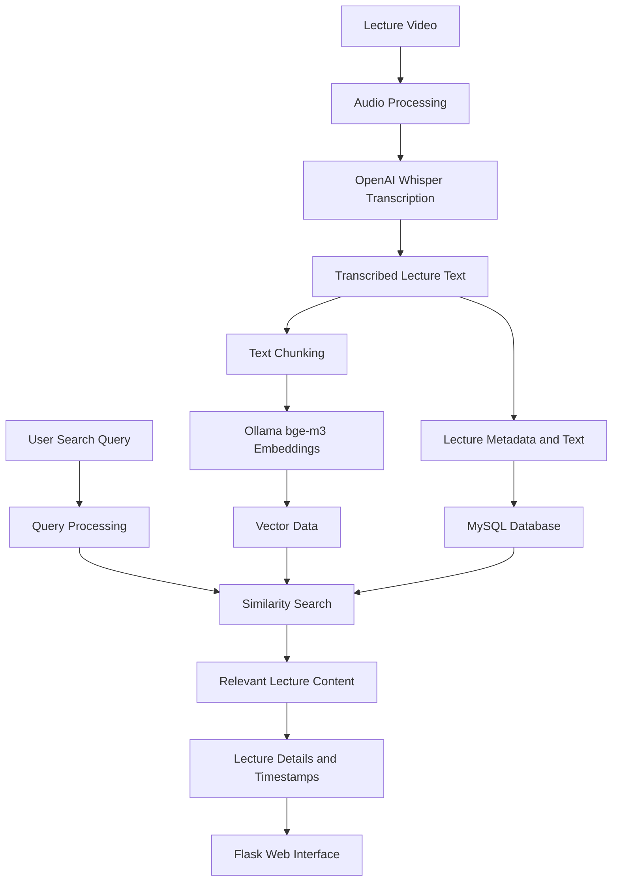
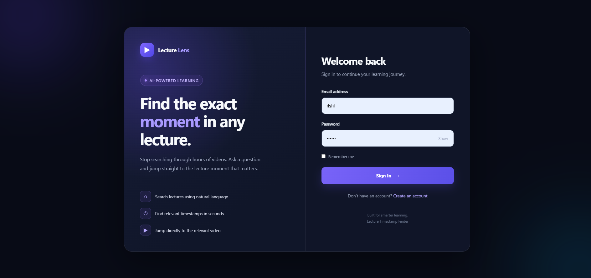
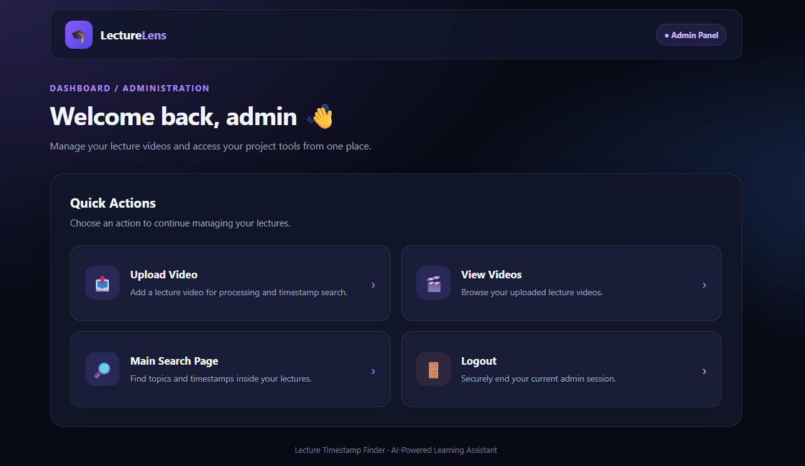
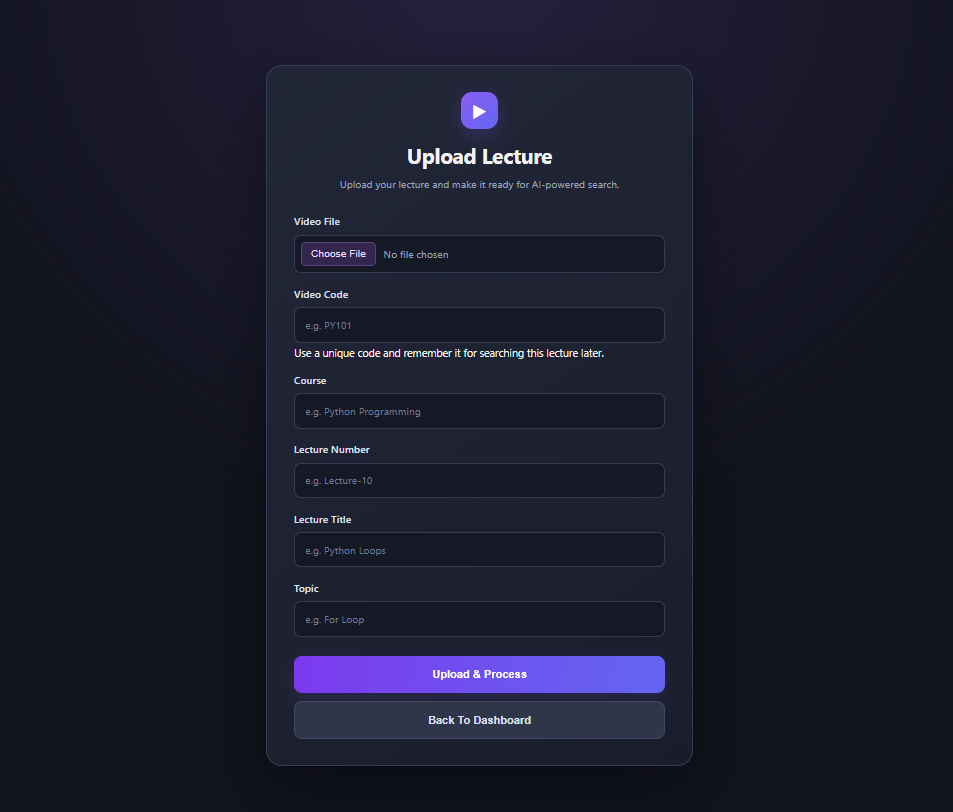
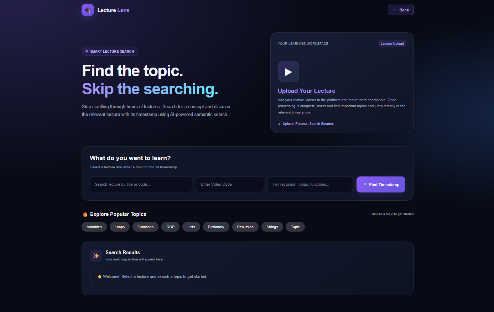

# 🎓 LectureLens

**Find Any Topic. Jump to the Exact Moment.**

LectureLens is a web application designed to help learners find specific
topics inside programming lecture videos without manually searching
through hours of content. It combines lecture transcription, text
embeddings, similarity search, database storage, and a Flask web
interface to help users locate relevant lecture moments.

------------------------------------------------------------------------

## 🌐 Live Demo

**Live Demo:** Coming soon --- deployment is planned.

-   **GitHub Repository:**
    [Rishiraj-Singh-Thakur/LectureLens](https://github.com/Rishiraj-Singh-Thakur/LectureLens)

------------------------------------------------------------------------

## 📌 Project Overview

The goal of LectureLens is to make programming lecture content easier to
search and revisit. Instead of scrubbing through a long video to find
one concept, users can search for a topic and find relevant lecture
content with associated timestamps.

The project brings together:

-   Lecture video upload and processing
-   Audio transcription using OpenAI Whisper
-   Text chunking for searchable lecture content
-   Embedding generation using Ollama's `bge-m3` model
-   Similarity-based retrieval using Scikit-learn
-   MySQL database integration
-   A Flask web application with HTML, CSS, and JavaScript
-   A search interface for locating topics and timestamps

------------------------------------------------------------------------

## 🎯 Core Use Case

### 🔎 Topic Search and Timestamp Discovery

LectureLens is designed to help users find where a concept is discussed
in a lecture.

Example searches include:

-   Where are Python loops explained?
-   Find the lecture about dictionaries.
-   Where is recursion covered?
-   Find the explanation of functions.
-   Which lecture discusses object-oriented programming?

The search workflow uses processed lecture content to retrieve relevant
matches and their associated lecture information.

------------------------------------------------------------------------

## ✨ Main Features

### 1. 🔐 Login Interface

A dedicated sign-in interface for accessing the application.

### 2. 🧑‍💻 Admin Dashboard

A central dashboard for accessing lecture-management tools, including
video upload, viewing uploaded videos, and the main search page.

### 3. 🎬 Lecture Upload

Upload a lecture video and provide metadata such as video code, course,
lecture number, lecture title, and topic.

### 4. 🎙️ Speech Transcription

Use OpenAI Whisper to convert lecture audio into text for downstream
processing.

### 5. 🧠 Embedding Generation

Use Ollama's `bge-m3` model to generate embeddings for lecture text.

### 6. 🔍 Similarity Search

Use a Scikit-learn-based similarity-search workflow to identify lecture
content relevant to a user's query.

### 7. ⏱️ Timestamp Discovery

Help users locate relevant moments in lecture content using the
associated timestamp information.

### 8. 🗄️ MySQL Integration

Store and retrieve lecture-related information through the MySQL
database.

### 9. 🌐 Web Interface

A Flask application with HTML, CSS, and JavaScript provides the
user-facing interface.

------------------------------------------------------------------------

## 🏗️ Project Architecture

The diagram below describes the overall lecture-processing and search
workflow.



*This is a high-level representation of the project workflow. Exact
processing steps and data flow may vary by implementation.*

------------------------------------------------------------------------

## 🔄 How It Works

### 1. Lecture Upload

A lecture video is submitted through the upload interface along with its
metadata.

### 2. Audio Processing

The processing workflow prepares audio from the video. FFmpeg is
required for media-processing tasks where configured by the project.

### 3. Transcription

OpenAI Whisper converts spoken lecture audio into text.

### 4. Text Preparation

The transcribed content is organized into smaller chunks for retrieval.
Relevant lecture metadata and timestamp information are used to connect
results back to the lecture.

### 5. Embedding Generation

Ollama's `bge-m3` model converts text into vector embeddings that can be
compared for semantic similarity.

### 6. Data Storage

Lecture information is stored in MySQL, while vector-related data is
handled by the project's vector workflow.

### 7. Search Query

A user selects or enters a lecture and topic through the search
interface.

### 8. Similarity Search

The search engine compares the query with processed lecture content to
find relevant matches.

### 9. Results

The application displays relevant lecture information and associated
timestamps, helping the user find the section to revisit.

------------------------------------------------------------------------

## 🧰 Tech Stack

### Programming

-   Python

### Backend and Web Framework

-   Flask

### Frontend

-   HTML
-   CSS
-   JavaScript

### Database

-   MySQL
-   Flask-MySQLdb / MySQL client libraries used by the project

### Speech Transcription

-   OpenAI Whisper

### Embeddings

-   Ollama
-   `bge-m3`

### Similarity Search and Data Processing

-   Scikit-learn
-   NumPy
-   Pandas

### Media Processing

-   FFmpeg

### Development and Version Control

-   Anaconda
-   VS Code
-   Git
-   GitHub

------------------------------------------------------------------------

## 📂 Project Structure

``` text
Lecture Timestamp Finder (Project -2)/
│
├── 01_data/                         # Local source and processing data
│   ├── 01_Videos/                   # Source lecture videos (local)
│   ├── 02_audios/                   # Extracted audio (local)
│   └── processing/                  # Intermediate processing files (local)
│
├── 02_vectors/
│   └── chunk_vectors.npy            # Local vector data (excluded from Git)
│
├── 03_backend/
│   ├── lecture_links.py             # Lecture links and related functionality
│   ├── search_engine.py             # Search and retrieval logic
│   ├── sql_practice.py              # SQL-related practice/code
│   └── uploading_on_database.py     # Database upload functionality
│
├── 04_scripts/                      # Processing and utility scripts
│
├── 05_templates/
│   └── templates/                   # HTML templates
│
├── 06_static/
│   └── static/                      # CSS, JavaScript, and static assets
│
├── screenshots/
│   ├── login.png
│   ├── admin-dashboard.png
│   ├── upload-lecture.png
│   └── search-page.png
│
├── app.py                           # Flask application entry point
├── requirements.txt                 # Python dependencies
├── .gitignore                       # Files excluded from Git
├── .env                             # Local configuration; do not commit
└── README.md                        # Project documentation
```

**Note:** `01_data/`, local media files, `.env`, and the generated
`02_vectors/chunk_vectors.npy` are intentionally excluded from Git. The
directory tree above documents the local project layout; files excluded
by `.gitignore` will not appear in the GitHub repository.

------------------------------------------------------------------------

## 📊 Data and Processing

LectureLens processes lecture content to make it searchable.

The workflow includes:

-   Video and audio handling
-   Speech-to-text transcription
-   Preparing text for retrieval
-   Generating embeddings for text chunks
-   Retaining lecture metadata and timestamp associations
-   Retrieving relevant content in response to a search query

The project uses lecture content supplied for processing. Dataset size
and processing benchmarks are not listed here because they depend on the
local lecture collection and have not been specified.

------------------------------------------------------------------------

## 🧠 Search Workflow

``` text
Lecture Video
     ↓
Audio Processing
     ↓
Whisper Transcription
     ↓
Text Preparation and Chunking
     ↓
Ollama bge-m3 Embeddings
     ↓
Vector and Database Storage
     ↓
User Topic Query
     ↓
Similarity Search
     ↓
Relevant Lecture Matches
     ↓
Lecture Details and Timestamps
```

------------------------------------------------------------------------

## 📸 Application Screenshots

The screenshots below show the current LectureLens interface.

### 🔐 Login Page



The sign-in interface introduces LectureLens and provides access to the
application.

### 🧑‍💻 Admin Dashboard



The dashboard provides quick access to video upload, uploaded videos,
and the main search page.

### 🎬 Upload Lecture



The upload form accepts a video file and lecture metadata, including
video code, course, lecture number, title, and topic.

### 🔎 Main Search Page



The search interface lets users choose a lecture, enter a topic, explore
popular programming topics, and view matching results.

------------------------------------------------------------------------

## ⚙️ Local Setup

### 1. Clone the Repository

``` bash
git clone https://github.com/Rishiraj-Singh-Thakur/LectureLens.git
cd LectureLens
```

### 2. Install Python Dependencies

Use a Python environment suitable for the project's dependencies, then
run:

``` bash
pip install -r requirements.txt
```

### 3. Install and Configure Required Tools

Make sure the following are installed and configured:

-   MySQL Server
-   Ollama
-   FFmpeg

Download the embedding model used by the project:

``` bash
ollama pull bge-m3
```

Ensure the Ollama service is running when the application needs it.

### 4. Configure Environment Variables

Create a `.env` file in the project root:

``` env
FLASK_SECRET_KEY=your_secret_key
MYSQL_HOST=localhost
MYSQL_PORT=3306
MYSQL_USER=your_mysql_username
MYSQL_PASSWORD=your_mysql_password
MYSQL_DATABASE=lecture_timestamp_finder
```

Replace example values with your local configuration. The database and
any required tables must be prepared before using database-dependent
features.

### 5. Run the Application

``` bash
python app.py
```

Open the local address printed in the terminal to use the application.
In a typical Flask development setup, this may be
`http://127.0.0.1:5000/`.

------------------------------------------------------------------------

## 🔐 Environment Variables and Security

The application reads configuration from environment variables.

  Variable             Purpose
  -------------------- ----------------------
  `FLASK_SECRET_KEY`   Secret key for Flask
  `MYSQL_HOST`         MySQL server host
  `MYSQL_PORT`         MySQL server port
  `MYSQL_USER`         MySQL username
  `MYSQL_PASSWORD`     MySQL password
  `MYSQL_DATABASE`     MySQL database name

Security practices:

-   Never commit `.env` files or credentials.
-   Keep API keys and secret values out of source code.
-   Keep large videos, audio files, and generated local data out of Git
    unless there is a clear reason to publish them.
-   Revoke and replace credentials if they have been exposed.

------------------------------------------------------------------------

## 🚀 Deployment

The code is available on GitHub. Deployment to Render is planned and the
live-demo link will be added after deployment is completed and verified.

Planned deployment workflow:

``` text
GitHub Repository
       ↓
Render Configuration
       ↓
Install Dependencies
       ↓
Configure Environment Variables and Services
       ↓
Start the Flask Application
       ↓
Verify the Live Application
```

**Deployment considerations:** LectureLens uses local services and
processing tools, including MySQL, Ollama, Whisper, and FFmpeg. A hosted
deployment will need a compatible plan for database access, model
availability, media processing, storage, and resource limits. Local
setup instructions alone do not guarantee that the application can run
unchanged on a hosted service.

------------------------------------------------------------------------

## 📚 Key Learnings

This project provides practical experience with:

-   Building a Flask web application
-   Designing a workflow for searching lecture content
-   Transcribing audio using Whisper
-   Preparing text for semantic retrieval
-   Generating embeddings using Ollama
-   Using similarity search to retrieve relevant content
-   Connecting Python applications to MySQL
-   Working with lecture metadata and timestamps
-   Organizing backend modules, templates, and static assets
-   Managing dependencies and environment variables
-   Version-controlling a project with Git and GitHub
-   Preparing a local application for deployment

------------------------------------------------------------------------

## 🔮 Future Improvements

Potential future improvements include:

-   Deploy the application and publish a verified live demo.
-   Add direct video links that open at the relevant timestamp.
-   Improve result ranking and search quality.
-   Add filters by course, lecture, or topic.
-   Expand support for additional subjects and lecture collections.
-   Improve progress feedback and error handling during video
    processing.
-   Add more detailed lecture-result previews.
-   Optimize embedding generation and vector retrieval for larger
    collections.
-   Add user-management improvements and more comprehensive testing.
-   Document deployment configuration once the hosted setup is verified.

------------------------------------------------------------------------

## 👨‍💻 Author

**Rishiraj Singh Thakur**\
*Data Science \| Machine Learning \| Python \| SQL*

-   🌐 **GitHub Repository:**
    [LectureLens](https://github.com/Rishiraj-Singh-Thakur/LectureLens)
-   💼 **LinkedIn:**
    [rishiraj-singh-thakur-jerry01](https://www.linkedin.com/in/rishiraj-singh-thakur-jerry01/)
-   🐦 **X (Twitter):**
    [@RishirajSingh_X](https://x.com/RishirajSingh_X)
-   📧 **Email:** <rishiirajsinghthakur@gmail.com>

------------------------------------------------------------------------

## ⭐ Project Highlights

-   ✅ **Lecture Topic Search:** Search for programming concepts in
    processed lecture content.
-   ✅ **Transcription Pipeline:** Use Whisper to turn lecture audio
    into text.
-   ✅ **Embedding-Based Retrieval:** Generate embeddings with Ollama
    `bge-m3`.
-   ✅ **Timestamp-Oriented Results:** Help users locate relevant
    moments in lectures.
-   ✅ **Database Integration:** Use MySQL to store and retrieve lecture
    information.
-   ✅ **Full-Stack Interface:** Build the application with Flask, HTML,
    CSS, and JavaScript.
-   ✅ **Version Controlled:** Maintain the project on GitHub with
    sensitive configuration excluded.

------------------------------------------------------------------------

*LectureLens is a work in progress. Features, setup steps, and
deployment options may evolve as the project develops.*
